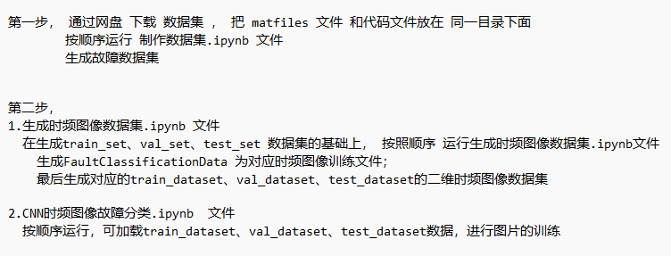
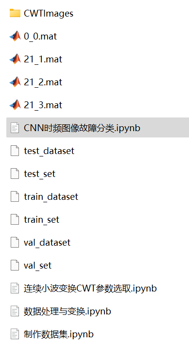

# Python Bearing Fault Continuous Wavelet Transform - Code and Time-Frequency Image Classification

Please remember to install Jupyter with pip for running code.
Then, follow the file order and run the code step by step, otherwise, directly running the classification code will result in errors!
1. Create a dataset.ipynb
2. Generate time-frequency image dataset.ipynb
3. CNN fault classification.ipynb
The Pycharm code files have been uploaded, which can be updated and downloaded!
This includes the complete CWRU bearing fault dataset, as well as the one-dimensional fault signal dataset and time-frequency image dataset that have been generated and prepared. The corresponding codes can all be run.
The main focus is on a detailed introduction to Python wavelet parameters and the experimental process.
Environment: Python 3.9
\n\n\n\n\n\n

## Images

<!-- PAYMENT_BLOCK -->

## Get this dataset

- Payment link (Stripe): [Buy now](https://buy.stripe.com/3cs8yP7sY87d0vu9AB)
- Payment QR code: 

<!-- /PAYMENT_BLOCK -->
